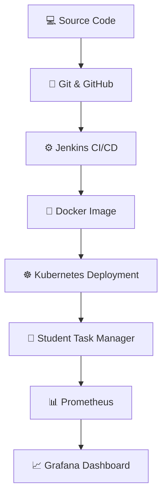

# ⚙️ DevOps for Scalable Systems Lab

  <strong>Practical Lab Work Record · TY B.Tech Information Technology</strong>
   
  A collection of DevOps assignments built around a Student Task Manager application.

  
  
  
  

---

## 📌 About This Repository

This repository serves as the practical lab work record for the **DevOps for Scalable Systems Lab (DOSS)**. It contains the assignments completed as part of the course, along with the base project used to implement and demonstrate the concepts covered in the practicals.

The common project is a **Student Task Manager web application**, which provides a practical foundation for exploring DevOps tools, deployment workflows, automation, and application monitoring.

## 🧪 Assignments & Topics

| Area | Concepts Covered |
|---|---|
| 🔀 Version Control | Git and GitHub |
| 🐳 Containerization | Docker images and containers |
| ⚙️ CI/CD | Jenkins pipelines and automation |
| ☸️ Orchestration | Kubernetes, Minikube, deployments, services, scaling, and self-healing |
| 📊 Monitoring | Prometheus metrics collection and PromQL queries |
| 📈 Visualization | Grafana dashboards and application performance metrics |

Each assignment includes relevant implementation files, configuration files, commands, and practical evidence, as applicable.

## 🔄 DevOps Workflow

*The diagram represents the overall workflow demonstrated by the project; the level of automation depends on the configuration implemented in the assignments.*

## 🛠️ Technology Stack

  

- **Application:** Student Task Manager
- **Version Control:** Git and GitHub
- **Containerization:** Docker
- **CI/CD:** Jenkins
- **Orchestration:** Kubernetes and Minikube
- **Monitoring & Visualization:** Prometheus and Grafana
- **Configuration:** YAML

## 🎯 Objective

To gain hands-on experience with DevOps principles and tools by implementing a structured workflow covering source code management, containerization, CI/CD automation, application deployment, scaling, and monitoring.

---

  Academic practical work · DevOps for Scalable Systems Lab

